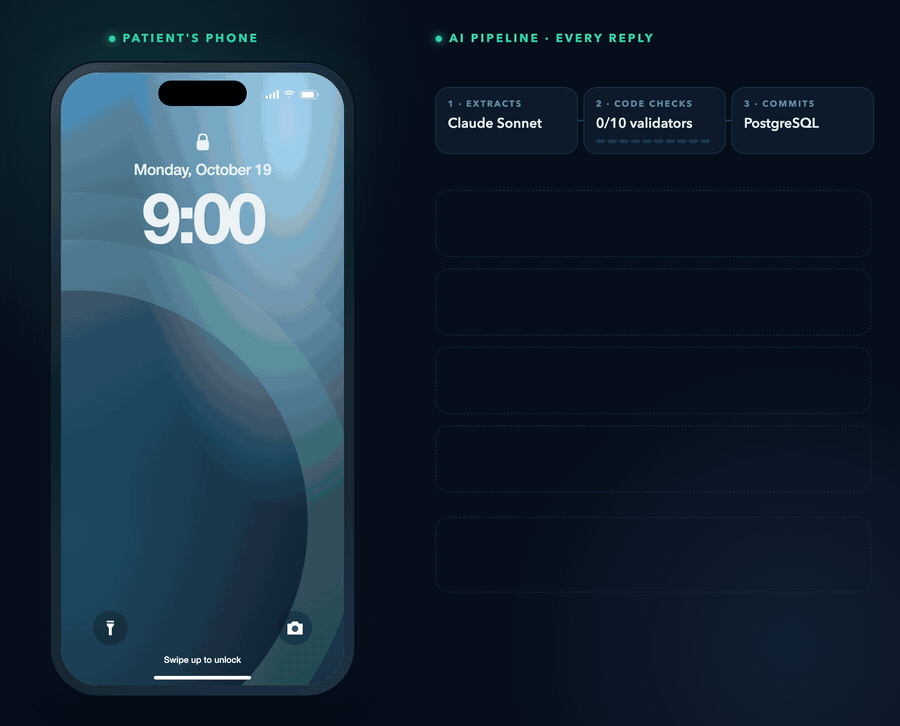
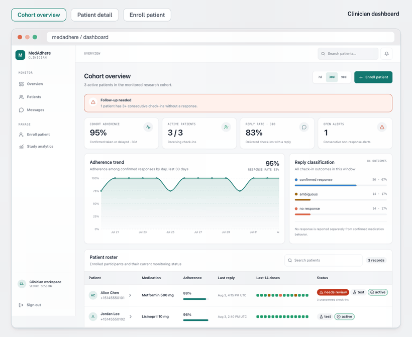
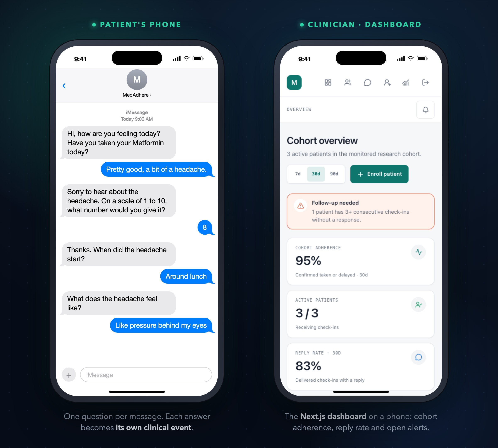
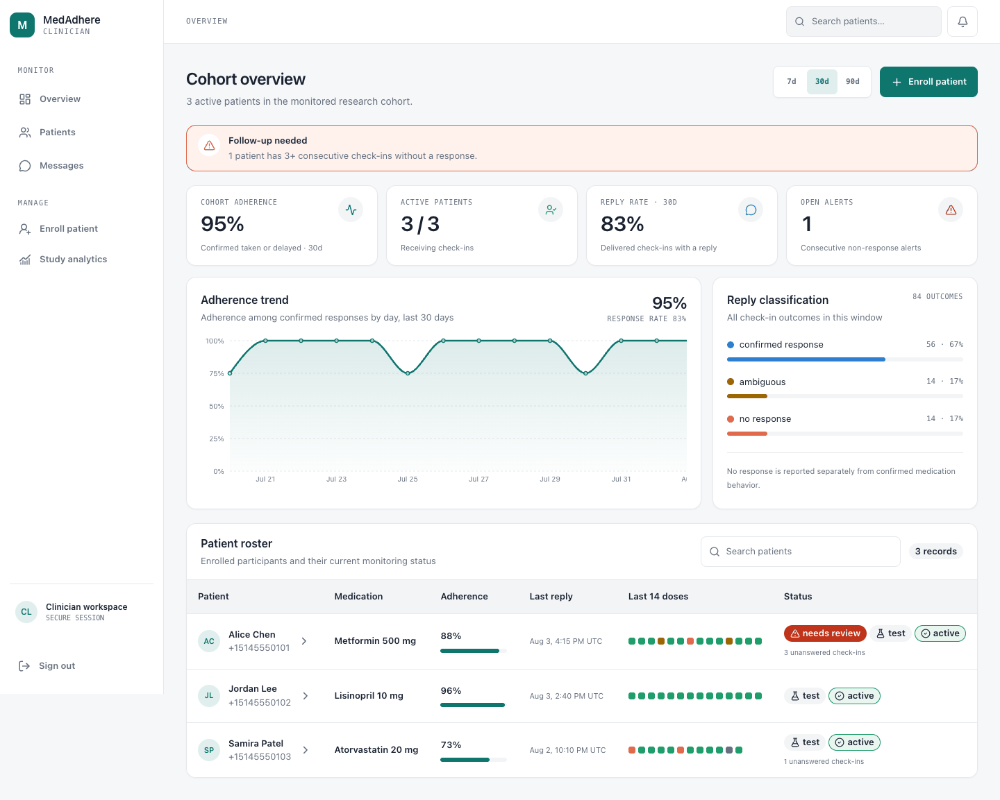
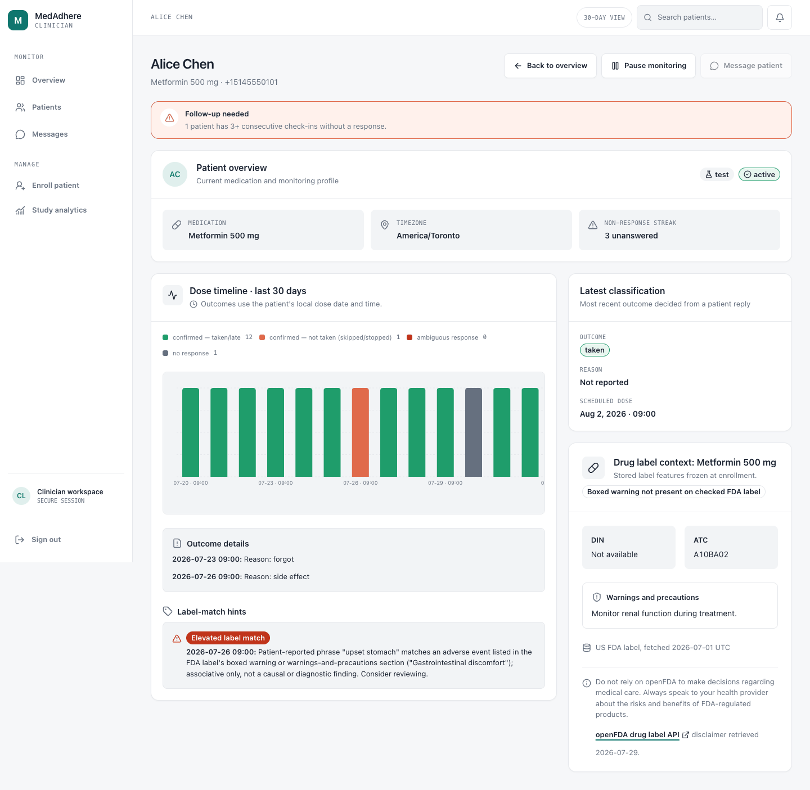
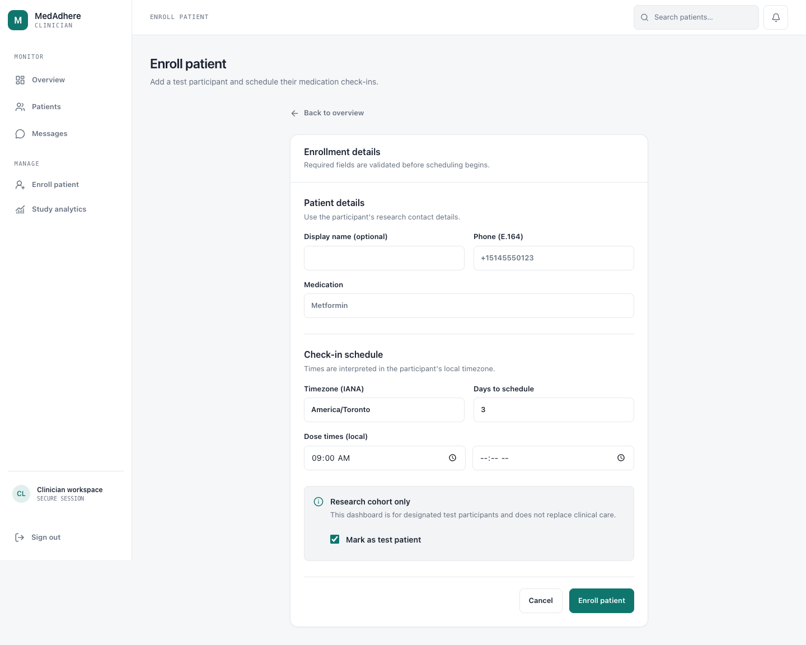
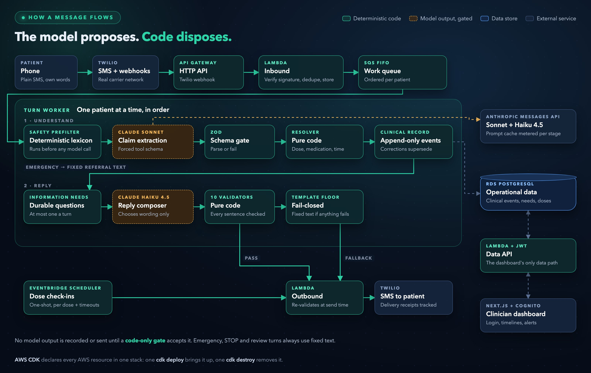

<h1 align="center">MedAdhere</h1>

<p align="center">
  MedAdhere checks each medication reply against the patient's saved record.<br>
  It links symptoms to earlier messages, matches medication reference data,<br>
  and records the facts, follow-up questions and review evidence for the clinician.
</p>

<p align="center">
  <br>
  <i>69-second overview. <a href="assets/launch.mp4">Watch it in HD (MP4)</a>.</i>
</p>

<p align="center">
  <a href="main.pdf"><b>Read the 40-page honours thesis (PDF)</b></a>
</p>

## What it is

MedAdhere texts a patient at each scheduled dose time. The patient replies in their own words, with no keywords or menu codes. An AI agent turns each reply into a structured clinical record, asks one follow-up question when something is missing, and a clinician sees the result on a web dashboard.

It runs on serverless AWS, sends real SMS through Twilio, and calls Claude through the Anthropic Messages API. Deterministic code decides what gets recorded and what gets sent.

## Key numbers

| Result | What it measures |
|---|---|
| **1.000** life-safety recall | 33 of 33 acute-physical and crisis messages caught on a 207-row hand-labeled gold set |
| **165 / 165** | life-safety trials caught across five repeated runs |
| **0.966** adherence-state accuracy | 200 of 207 rows, against 0.705 for a keyword and regex matcher |
| **1.00** structured-output validity | 27 of 27 provider turns in the pre-registered conversation evaluation |
| **3,483** passing tests | across 227 files, run against a real PostgreSQL instance |
| **90.43%** statement coverage | last measured, with 85.63% branch coverage |
| **16 s** | end to end, from a patient's text to the agent's reply, on real carrier infrastructure |
| **10** runtime validators | pure-code checks on every generated SMS before it can be sent |

## See it working

<p align="center">
  <br>
  <i>Follow Alice's reply through her saved history, medication references, question priorities and escalation rules. Then open Alice from the patient roster and explore her day thread, charts, history, source messages and clinician controls. The processing sequence explains the implementation; all patient and cohort data are synthetic. <a href="assets/chat.mp4">Watch the full walkthrough (MP4)</a> · <a href="assets/chat.gif">Full-size GIF</a>.</i>
</p>

<p align="center">
  <br>
  <i>The Next.js clinician dashboard: cohort overview, patient detail and enrollment.</i>
</p>


<p align="center">
  <br>
  <i>Example conversation, shown as a mockup, beside the real mobile dashboard. The agent asks how strong the headache is, when it started, then what it feels like, one question per message.</i>
</p>

<details>
<summary><b>Full-size dashboard screenshots</b></summary>
<br>

<table>
  <tr>
    <td colspan="2" align="center">
      <br>
      <i>Cohort overview: adherence, active patients, reply rate, open alerts and a 30-day trend.</i>
    </td>
  </tr>
  <tr>
    <td width="50%" align="center">
      <br>
      <i>Patient detail: dose timeline, outcome reasons, a label-match hint and drug-label context frozen at enrollment.</i>
    </td>
    <td width="50%" align="center">
      <br>
      <i>Enrollment: phone, medication, timezone and local dose times. Check-ins are scheduled from here.</i>
    </td>
  </tr>
</table>

</details>

<p align="center"><i>All dashboard data shows synthetic test patients. Phone numbers are in the fictional 555 range.</i></p>

## How it works

<p align="center">
  
</p>

- **Model output is checked before it changes a record.** The system makes two model calls. Claude Sonnet extracts claims from the reply and Claude Haiku 4.5 drafts the wording of the answer. Neither call can write a clinical fact. Pure code resolves each claim to a dose, a medication and a time, and decides what is recorded, asked and sent.
- **Constrained generation behind a parse-or-fail gate.** Each request declares exactly one tool and pins `tool_choice` to it, so the model cannot answer in prose. A shared Zod schema then parses the output. Anything that fails the parse is never written.
- **An append-only clinical record.** Every fact is an event in PostgreSQL. A correction appends a new event that supersedes the old one, so the record keeps both what the patient said first and what they believe now. Open questions live in the database as durable information needs, because an SMS conversation has no session.
- **Ten validators over a fail-closed template floor.** Every drafted SMS must pass ten pure-code checks: grounding in what the patient said, no medication advice, no reassurance, no injection markers, GSM-7 and length. Any failure falls back to a fixed template. The full set runs again at send time against the stored text.
- **Safety never depends on the model.** A deterministic lexicon prefilter runs before any model call. Emergency replies are fixed text pointing to 911 or the 9-8-8 crisis line. Emergency, STOP and review turns never reach the composer.
- **Serverless and event-driven.** API Gateway receives the Twilio webhook. The Inbound Lambda verifies the signature, deduplicates on the message ID and stores the reply before any model work starts. An SQS FIFO queue keyed by patient processes each patient's messages in order, so a correction never overtakes the message it corrects. EventBridge Scheduler fires one-shot check-ins per dose and detects non-response.

## Highlights

- **Pre-registered evaluation.** Gates, thresholds and analysis rules were fixed before each run. The classifier results report exact confidence intervals, a confusion matrix, per-class support, deterministic baselines and a guarded ablation.
- **Prompt caching, metered per stage.** One 27-turn run read 103,766 input tokens from cache, against 3,991 tokens to create the cache and 8,028 uncached. That run cost $0.09 in total.
- **Cheap to evaluate.** The 207-call classifier evaluation cost about $0.00174 per classification, under a hard per-run spend cap.
- **Prompt-injection defenses.** Patient text is treated as data. The composer wraps it in a delimited block closed by a per-request nonce, replaces medication names with aliases before the model sees them, and blocks a canary token if it leaks.
- **Bulkheads and an auto-disable.** The composer has its own provider circuit and token budget. If fallbacks pass 30% of compositions in a rolling hour, it turns itself off and templates ship.
- **Locked-down data path.** The dashboard never talks to PostgreSQL. It calls a JWT-authorized data API Lambda inside the VPC, and a CI guard fails the build if a database client appears in the dashboard package.
- **One-command infrastructure.** AWS CDK declares the whole stack. One `cdk deploy` brings it up and one `cdk destroy` removes it, database included.
- **Drug reference data.** At enrollment the system resolves the medication through RxNorm, pulls the openFDA label, checks Health Canada's Drug Product Database, and matches reported side effects against OnSIDES as associative hints for the clinician.

## Tech stack

| Area | Tools |
|---|---|
| Language | TypeScript, npm-workspaces monorepo (`infra/`, `backend/`, `dashboard/`, `packages/shared/`) |
| AI | Anthropic Messages API, Claude Haiku 4.5, Claude Sonnet, forced tool use, prompt caching, Zod schemas |
| AWS | CDK, Lambda (Node.js, ARM64), API Gateway HTTP API, SQS FIFO, EventBridge Scheduler, RDS PostgreSQL 16, Cognito, Secrets Manager, CloudWatch |
| Messaging | Twilio SMS (REST API), signed webhooks, delivery-status callbacks |
| Dashboard | Next.js App Router, React, Recharts, Cognito Hosted UI with OAuth 2 and PKCE, hosted on Vercel |
| Testing | 3,483 tests across 227 files, run against a real PostgreSQL container |
| Data sources | RxNorm, openFDA, Health Canada Drug Product Database, OnSIDES |

## The thesis

**MedAdhere: A Serverless SMS Platform for Medication-Adherence Monitoring with a Bounded-Authority Conversational Clinical Agent**

Bader El-Asadi. COMP 4905 Honours Project, School of Computer Science, Carleton University, Summer 2026.

[Read the 40-page thesis (PDF)](main.pdf)

| Chapter | What it covers |
|---|---|
| Introduction | Motivation, problem statement and contributions |
| Background | The ABC adherence taxonomy, SMS interventions, LLM classification, serverless design |
| System architecture | AWS stack, data model, message pipelines, safety layer, dashboard |
| Conversational agent | Bounded authority, claim extraction, the append-only record, the composer and its validators |
| Classifier evaluation | Gold set, metrics and thresholds, safety repeatability, ablation |
| Results | Accuracy, safety recall, baselines, cost |

## Repository layout

This repository holds the thesis source.

```
main.tex          entry point: title page, abstract, chapter order
chapters/         one .tex file per chapter
generated/        tables and figures included by the chapters
style/            fonts, palette and heading styles
figures/          dashboard screenshots used in the thesis
references.bib    bibliography
main.pdf          the built thesis
assets/           README images, GIFs and launch video; HTML sources and render scripts in assets/src/
```

## Build the PDF

```sh
tectonic -X compile main.tex
```

It also builds on Overleaf with pdfLaTeX and BibTeX.
